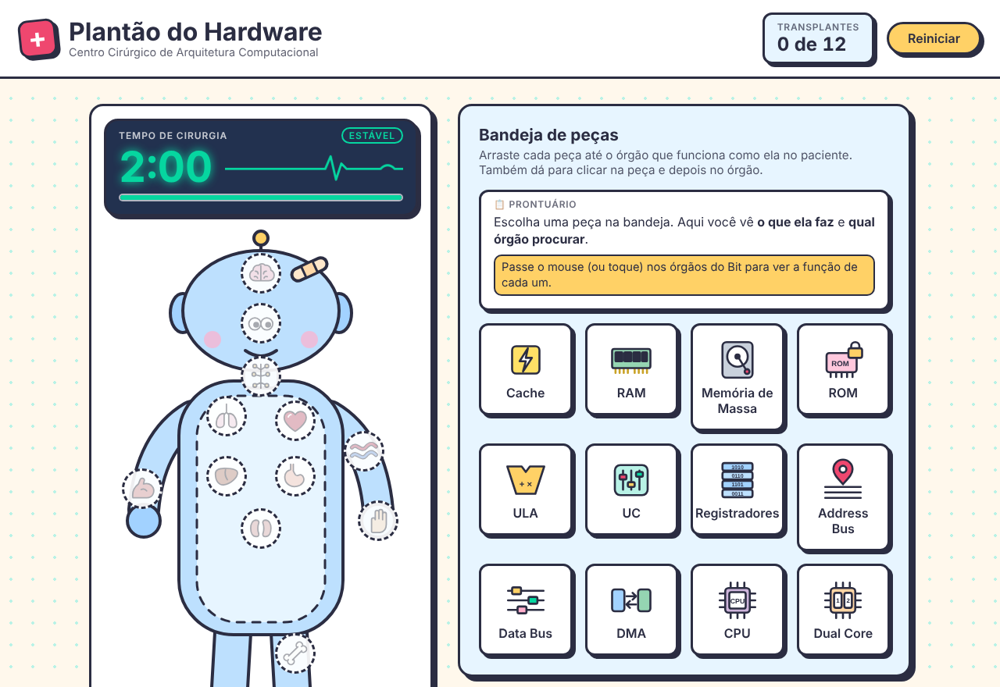
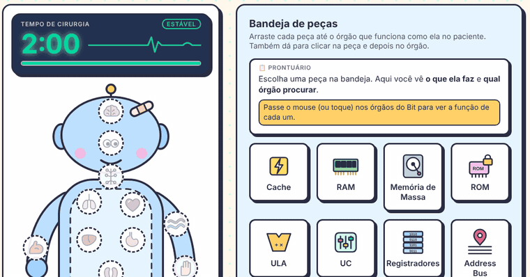
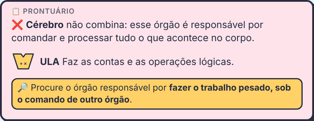
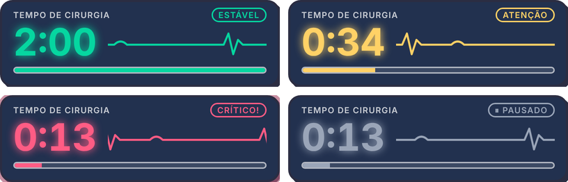
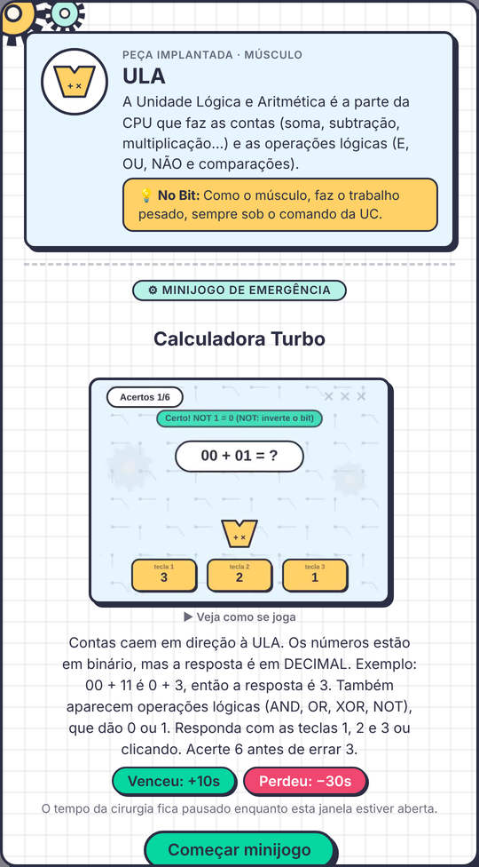
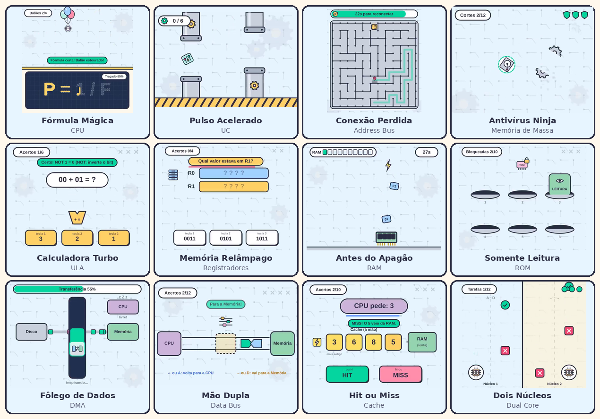

# 🩺 Plantão do Hardware

Um paciente muito estranho chegou ao hospital: o **Bit**. Cada órgão dele funciona como uma **peça de computador**. Coloque cada peça no órgão certo antes de o tempo acabar e aprenda Arquitetura Computacional jogando.

🔗 **[Jogue aqui](https://SEU-USUARIO.github.io/arqcomp-cruzadinha/)**  ·  Atividade da disciplina **Arquitetura Computacional**

<p align="center">
  
</p>

## 🎮 Como jogar

**Arraste a peça até o órgão que funciona como ela.** O prontuário dá a dica e o Bit reage quando você acerta.

<p align="center">
  
</p>

<table>
  <tr>
    <td width="50%" align="center">
      <br>
      <b>Errou?</b> −5 s, e o prontuário explica o porquê.
    </td>
    <td width="50%" align="center">
      <br>
      <b>Monitor de tempo:</b> verde, amarelo, vermelho e pausado.
    </td>
  </tr>
</table>

## 🔊 Som

Trilha sonora e efeitos, gerados na hora pelo próprio navegador, sem arquivos de áudio. Use os botões **🎵** (música) e **🔊** (efeitos) do topo para ligar ou desligar; a escolha fica salva.

## 🧩 Peças e órgãos

| Peça | Órgão | Por que combina |
|------|-------|-----------------|
| CPU | 🧠 Cérebro | Comanda e processa tudo | 
| Registradores | 👀 Olhos | Seguram só o que está sendo usado agora | 
| Address Bus | ⚡ Nervos | Dizem PARA ONDE a informação vai | 
| DMA | 🫁 Pulmões | Trocam com o mundo sem o cérebro pensar | 
| UC | ❤️ Coração | Dá o ritmo (clock) e sincroniza tudo | 
| Memória de Massa | 🟤 Fígado | Guarda reservas por muito tempo | 
| RAM | 🍽️ Estômago | Guarda por pouco tempo e esvazia | 
| Dual Core | 🫘 Rins | Dois iguais trabalhando juntos | 
| ULA | 💪 Músculo | Faz o trabalho pesado: as contas | 
| Data Bus | 🩸 Veias | Dados indo e voltando | 
| Cache | ✋ Mão | Deixa "à mão" o que mais se usa | 
| ROM | 🦴 Ossos | Estrutura fixa, "de fábrica" | 

## ⚙️ Minijogos

A cada acerto, a peça é explicada e começa **o minijogo dela**, com um vídeo de demonstração antes. O tempo fica **pausado**: vencer dá **+10 s** e perder tira **−30 s**.

<p align="center">
  
</p>

<p align="center">
  
</p>

<details>
<summary><b>Controles de cada minijogo</b></summary>

| Minijogo | Controles |
|----------|-----------|
| Fórmula Mágica (CPU) | Desenhar com o mouse: **P = 1 / F** e **T = CPI × P** |
| Pulso Acelerado (UC) | `Espaço` |
| Conexão Perdida (Address Bus) | `W` `A` `S` `D` |
| Antivírus Ninja (Memória de Massa) | Arrastar o mouse para cortar |
| Calculadora Turbo (ULA) | `1` `2` `3` ou clique (`00 + 11` → **3**) |
| Memória Relâmpago (Registradores) | `1` `2` `3` ou clique |
| Antes do Apagão (RAM) | `←` `→` / `A` `D` ou mouse |
| Somente Leitura (ROM) | Clique ou `1`–`6` |
| Fôlego de Dados (DMA) | Segurar `Espaço` ou o mouse |
| Mão Dupla (Data Bus) | `←` `→` / `A` `D` |
| Hit ou Miss (Cache) | `←`/`H` e `→`/`M` |
| Dois Núcleos (Dual Core) | `A` `D` e `←` `→` |

No celular, aparecem botões na tela.
</details>

## 🗂️ Estrutura

```
index.html            página e desenho do paciente
css/style.css         visual
js/pieces.js          peças, órgãos, textos e configurações
js/game.js            lógica da cirurgia
js/audio.js           trilha sonora e efeitos (Web Audio API)
js/minigames/         um arquivo por minijogo + manager.js
assets/videos/        vídeos de demonstração
assets/readme/        imagens deste README
```

## 🛠️ Tecnologias

HTML · CSS · JavaScript puro · Canvas 2D · Web Audio API · GitHub Pages

Para jogar localmente, basta abrir o `index.html` no navegador.
